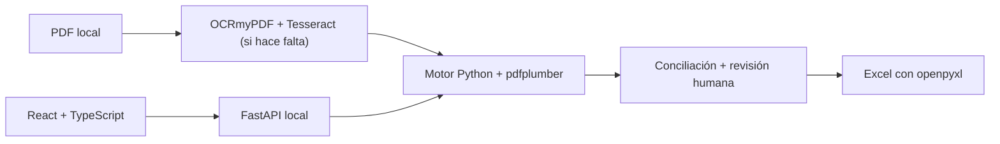

# OCR de presupuestos: piloto local con revisión humana

Este piloto nació de una tarea concreta: pasar partidas de un presupuesto en PDF a una tabla que se pueda revisar y trabajar en Excel. Copiar los valores a mano era lento y una lectura dudosa podía cambiar un importe. Por eso el flujo combina extracción, comprobaciones numéricas y una decisión humana cuando la evidencia no alcanza.

Para usarlo, cada persona carga **su propio PDF**. El repositorio no incluye presupuestos de entrada. La salida es un Excel local; el resultado depende de la estructura del documento y debe revisarse antes de utilizarse.

## Qué demuestra

- **Extracción:** Python y pdfplumber leen texto y coordenadas; si el PDF es escaneado, OCRmyPDF y Tesseract pueden preparar una copia con texto.
- **Calidad de datos:** el motor reconstruye partidas y jerarquías, conserva el valor original, normaliza sólo cuando hay evidencia suficiente y compara sumas y subtotales con `Decimal`.
- **Revisión humana:** una observación dudosa no se corrige silenciosamente. La interfaz permite revisar la evidencia antes de generar una exportación.
- **Integración local:** FastAPI recibe archivos por una ruta limitada al equipo local; React y TypeScript ofrecen carga, revisión, configuración de columnas y descarga.
- **Pruebas:** suites separadas para motor, API y frontend. Los casos públicos emplean datos inventados.

El proyecto muestra cómo traduje una necesidad operativa en reglas de extracción, controles y una interfaz para revisar el resultado. Es un piloto local, no un servicio desplegado. El cliente web conserva el nombre **Quipta** del prototipo de interfaz; aquí se conecta al motor OCR para el uso con PDF propio.

## Arquitectura



Hay dos maneras de trabajar: el comando Python procesa un PDF propio directamente; la interfaz local permite cargarlo, revisar partidas y descargar el Excel. La interfaz también tiene un ejemplo navegable para conocer los pasos sin aportar un archivo; ese ejemplo no procesa un PDF ni habilita una descarga. El backend conserva un contrato protegido de integración, separado del uso local y sin credenciales incluidas.

## Procesar un PDF propio

Para un PDF que ya contiene texto seleccionable, desde la raíz del proyecto:

```bash
python3 -m venv .venv
.venv/bin/python -m pip install -r requirements.txt
.venv/bin/python procesar_presupuestos.py --processed-pdf /ruta/a/tu_presupuesto.pdf --output salida/mi_presupuesto.xlsx
```

Si el PDF es una imagen escaneada, instala OCRmyPDF y Tesseract con idioma español en tu equipo y usa `--source-pdf` en lugar de `--processed-pdf`. El archivo Excel se genera en la ruta indicada por `--output`; el PDF y el resultado permanecen en tu equipo. La extracción depende de la estructura del documento y puede requerir revisión o ajustes para formatos distintos.

## Ejecutar las pruebas

Probado con Python 3.12.14 y Node.js 24; otras versiones no se verificaron en esta preparación. Desde la raíz:

```bash
python3 -m venv .venv
.venv/bin/python -m pip install -r backend/requirements-dev.txt
.venv/bin/python -m unittest discover -s tests -v
PYTHONPATH=. .venv/bin/python -m pytest -q backend/tests
cd frontend
npm ci
npm test
npm run lint
npm run build
npm audit
```

Las herramientas OCR del sistema no son instaladas por `requirements.txt`. La ejecución local de la API se explica en [backend/README.md](backend/README.md); el cliente y sus límites en [frontend/README.md](frontend/README.md). El servidor de desarrollo sólo escucha en `127.0.0.1`.

## Límites y privacidad

Esta copia no incluye PDF ni resultados de trabajo reales. Las pruebas del motor usan números y nombres inventados; pasar esas pruebas no demuestra que cualquier formato de presupuesto funcione. Para ampliar la compatibilidad hacen falta documentos de prueba que puedan utilizarse con permiso.

En el flujo web local, el PDF llega a la API en `127.0.0.1` y permanece temporalmente en el almacenamiento privado del trabajo para poder mostrarlo durante la revisión. No desaparece del servidor por recargar la página: la limpieza de resultados vencidos se realiza al iniciar la API o con el comando de mantenimiento. El Excel y los archivos de salida también pueden contener información sensible. Revisa cualquier archivo antes de compartirlo; `.gitignore` ayuda a evitar inclusiones accidentales. Esta copia no envía PDF a servicios en la nube.

**Procedencia:** adaptación independiente de un prototipo privado. El historial, las etiquetas y las Releases originales no forman parte de esta edición. No se ha concedido una licencia de reutilización del código.
