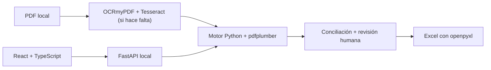

# OCR de presupuestos: piloto local con revisión humana

Proyecto de portafolio que convierte tablas de presupuestos en PDF a un Excel estructurado. Cada persona que lo ejecute debe aportar su propio PDF: el repositorio no incluye documentos de entrada. El motor separa las lecturas ambiguas para revisión humana y comprueba los importes con aritmética decimal.

## Qué demuestra

- **Extracción:** Python y pdfplumber leen texto y coordenadas; si el PDF es escaneado, OCRmyPDF y Tesseract pueden preparar una copia con texto.
- **Calidad de datos:** el motor reconstruye partidas y jerarquías, conserva el valor original, normaliza sólo cuando hay evidencia suficiente y compara sumas y subtotales con `Decimal`.
- **Revisión humana:** una observación dudosa no se corrige silenciosamente. La interfaz permite revisar la evidencia antes de generar una exportación.
- **Integración local:** FastAPI recibe archivos por una ruta limitada al equipo local; React y TypeScript ofrecen carga, revisión, configuración de columnas y descarga.
- **Pruebas:** suites separadas para motor, API y frontend. Los casos públicos emplean datos inventados.

La solución nació de un problema operativo de extracción y control de presupuestos. Como evidencia profesional, muestra análisis del proceso, validación de resultados y construcción progresiva de un flujo de software. No representa un producto desplegado ni una especialización avanzada en infraestructura.

## Arquitectura



El motor también se puede utilizar por línea de comandos. La interfaz incluye un recorrido demostrativo con datos ficticios y un recorrido local conectado a la API. En el recorrido local se carga un PDF propio, se revisan las partidas y se descarga el Excel; la demostración no procesa PDF ni produce una descarga real. El backend dispone además de un contrato protegido para integraciones futuras; su configuración requiere credenciales externas, nunca incluidas aquí.

## Procesar un PDF propio

Para un PDF que ya contiene texto seleccionable, desde la raíz del proyecto:

```bash
python3 -m venv .venv
.venv/bin/python -m pip install -r requirements.txt
.venv/bin/python procesar_presupuestos.py --processed-pdf /ruta/a/tu_presupuesto.pdf --output salida/mi_presupuesto.xlsx
```

Si el PDF es una imagen escaneada, instala OCRmyPDF y Tesseract con idioma español en tu equipo y usa `--source-pdf` en lugar de `--processed-pdf`. El archivo Excel se genera en la ruta indicada por `--output`; el PDF y el resultado permanecen en tu equipo. La extracción depende de la estructura del documento y puede requerir revisión o ajustes para formatos distintos.

## Ejecutar las pruebas

Probado con Python 3.12.14 y Node.js 24; otras versiones no se verificaron en esta preparación. Desde la raíz:

```bash
python3 -m venv .venv
.venv/bin/python -m pip install -r backend/requirements-dev.txt
.venv/bin/python -m unittest discover -s tests -v
PYTHONPATH=. .venv/bin/python -m pytest -q backend/tests
cd frontend
npm ci
npm test
npm run lint
npm run build
npm audit
```

Las herramientas OCR del sistema no son instaladas por `requirements.txt`. La ejecución local de la API se explica en [backend/README.md](backend/README.md); el cliente y sus límites en [frontend/README.md](frontend/README.md). El servidor de desarrollo sólo escucha en `127.0.0.1`.

## Límites y privacidad

Esta copia no incluye PDF reales, aprobaciones originales, Excel o logs de trabajo, manifiestos con huellas de documentos ni materiales de diseño no revisados. La suite pública del motor fue reescrita con números y nombres ficticios; por tanto, sus resultados no equivalen a una regresión sobre el presupuesto de referencia privado. La generalización a formatos nuevos requiere más documentos de prueba autorizados.

El procesamiento local de archivos propios puede generar salidas sensibles en el equipo de quien lo ejecute. Las reglas de `.gitignore` excluyen esos archivos, pero cada persona debe verificar su contenido antes de compartirlo. Esta copia no envía un PDF a servicios en la nube.

**Procedencia:** adaptación independiente de un prototipo privado. El historial, las etiquetas y las Releases originales no forman parte de esta edición. No se ha concedido una licencia de reutilización del código.
